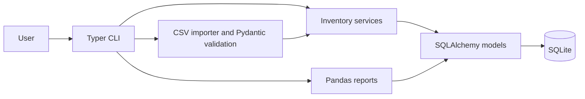

# StockPilot

StockPilot is a small Python 3.12 command-line application for tracking warehouse inventory. It records incoming lots with their purchase cost, ships stock using first-in, first-out (FIFO) costing, transfers lots between warehouses, imports invoice CSV files, and creates pandas reports.

## Architecture



The CLI handles input and presentation. Inventory services apply changes inside database transactions. Each receipt creates a costed lot; shipment consumes the oldest lots first. A transfer preserves the source lot costs and receipt dates at the destination, so FIFO order survives the move. The stock movement ledger supports historical COGS and turnover reports. CSV rows are validated independently, so valid lines are committed while rejected lines are written to a neighboring `*.errors.csv` file.

SQLite keeps a local install self-contained. SQLAlchemy provides a small database boundary, Pydantic validates imported rows, and pandas assembles tabular reports and Excel workbooks.

## Run locally

Create an environment and install the project with its development tools:

```bash
python -m venv .venv
source .venv/bin/activate
python -m pip install -e ".[dev]"
cp .env.example .env
```

On Windows PowerShell, activate with `.venv\Scripts\Activate.ps1` and copy the example with `Copy-Item .env.example .env`.

The default database is `data/stockpilot.db`. To use another SQLite file, set `STOCKPILOT_DATABASE_URL` in `.env`.

## Run with Docker

Docker Compose builds the CLI image and keeps the database in a named volume. For example:

```bash
docker compose run --rm stock --help
docker compose run --rm stock receive --sku COF-001 --product-name "Arabica coffee" --warehouse Main --quantity 24 --unit-cost 8.50 --received-on 2026-10-01 --min-stock 5
```

## Commands

Receive a lot:

```bash
stock receive --sku COF-001 --product-name "Arabica coffee" --warehouse Main --quantity 24 --unit-cost 8.50 --received-on 2026-10-01 --min-stock 5
```

Ship units and display their FIFO cost:

```bash
stock ship --sku COF-001 --warehouse Main --quantity 6 --shipped-on 2026-10-03
```

Transfer units to another warehouse:

```bash
stock transfer --sku COF-001 --source Main --destination East --quantity 4 --transferred-on 2026-10-04
```

Import the included sample invoice. Invalid rows are recorded in `examples/invoice.csv.errors.csv`:

```bash
stock import examples/invoice.csv
```

View balances, products below their minimum, and turnover for a date range:

```bash
stock report inventory
stock report lowstock
stock report turnover --from 2026-10-01 --to 2026-10-31
stock report excel --output reports/stock.xlsx --from 2026-10-01 --to 2026-10-31
```

The turnover ratio is period COGS divided by the average of opening and closing inventory value. Opening and closing values are reconstructed from the dated movement ledger. Transfers do not count as COGS.

## Development

```bash
ruff check .
ruff format --check .
pytest
```

GitHub Actions runs these commands on pushes and pull requests.
