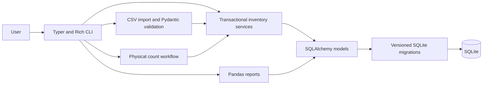

# StockPilot

StockPilot is a Python 3.12 command-line tool for day-to-day warehouse stock control. It tracks costed receipt lots, issues stock with FIFO costing, moves stock between warehouses, prevents duplicate invoice imports, reconciles physical counts, and records customer returns against their original shipment costs. Reports show warehouse balances, low stock, turnover, and non-sales losses; they can be exported to CSV or Excel.

The command-line interface is in Russian. Source code, this README, and report field names are in English.

## Architecture



Each receipt creates an inventory lot with its purchase date and unit cost. Shipments, write-offs, and inventory shortages consume the oldest available lots first. Customer returns point to shipment lines and restore the original unit costs. Transfers preserve lot dates and costs. The movement ledger records the warehouse, date, quantity, reason, and related shipment or count where applicable.

Invoice imports are unique by both invoice number and SHA-256 file hash. Valid CSV rows are imported independently; invalid rows are written to a neighboring `*.errors.csv` report. A count export includes the expected balance and a cost hint. Applying a count checks that the expected balance has not changed since export, shows the differences and values, then asks for confirmation unless `--yes` is supplied.

SQLite is the default database so a local installation needs no separate database service. SQLAlchemy maps the inventory records, Pydantic validates CSV input, pandas builds reports, and Rich renders readable terminal tables. The application uses explicit schema versions: an existing unversioned database is treated as version 1 and upgraded to version 2 without dropping its stock data.

## Install

Python 3.12 is required. Install the project and development tools in a virtual environment:

```bash
python -m venv .venv
source .venv/bin/activate
python -m pip install -e ".[dev]"
cp .env.example .env
```

On Windows PowerShell:

```powershell
python -m venv .venv
.\.venv\Scripts\Activate.ps1
python -m pip install -e ".[dev]"
Copy-Item .env.example .env
```

The default database is `data/stockpilot.db`. Configure another SQLite file with `STOCKPILOT_DATABASE_URL` in `.env`.

## Run with Docker Compose

Compose builds the CLI image and keeps its SQLite database in a named volume:

```bash
docker compose run --rm stock --help
docker compose run --rm stock receive --sku COF-001 --product-name "Arabica coffee" --warehouse Main --quantity 24 --unit-cost 8.50 --received-on 2026-10-01 --min-stock 5
```

## Commands

Receive a costed lot and ship FIFO stock. The shipment command prints a reference number for customer returns:

```bash
stock receive --sku COF-001 --product-name "Arabica coffee" --warehouse Main --quantity 24 --unit-cost 8.50 --received-on 2026-10-01 --min-stock 5
stock ship --sku COF-001 --warehouse Main --quantity 6 --shipped-on 2026-10-03
```

Transfer stock without changing its acquisition costs. Record a loss by reason; supported reasons are `брак`, `порча`, `недостача`, and `пересорт`:

```bash
stock transfer --sku COF-001 --source Main --destination East --quantity 4 --transferred-on 2026-10-04
stock write-off --sku COF-001 --warehouse Main --quantity 1 --reason порча --occurred-on 2026-10-05
```

Return stock using the shipment reference printed by `stock ship`. A return cannot exceed the quantity originally shipped less earlier returns:

```bash
stock return --shipment-id 1 --quantity 2 --returned-on 2026-10-06
```

Import an invoice. The CSV must include an `invoice_number` column; the sample file is [examples/invoice.csv](examples/invoice.csv). Reimporting its invoice number or file hash is rejected. Invalid rows are saved beside the source file:

```bash
stock import examples/invoice.csv
```

Export expected balances for one warehouse, enter the physical quantities in `counted_quantity`, and apply the file. The command previews the plan, actual count, difference, and cost impact before asking for confirmation. `--yes` confirms automatically:

```bash
stock count export --warehouse Main --output counts/main.csv
stock count apply counts/main.csv
stock count apply counts/main.csv --yes
```

Positive differences are recorded as costed receipts. Shortages are FIFO write-offs with reason `недостача`. The exported unit cost is the weighted current cost, or the latest known acquisition cost for a product that currently has no units in that warehouse.

Browse catalog and movement history:

```bash
stock products
stock products --search COF
stock history COF-001
stock warehouses
stock demo
```

Show inventory reports, filter by warehouse, export any tabular report to CSV, or export all reports to Excel:

```bash
stock report inventory
stock report inventory --warehouse Main --csv reports/main-stock.csv
stock report lowstock
stock report lowstock --warehouse Main --csv reports/main-low-stock.csv
stock report turnover --from 2026-10-01 --to 2026-10-31 --csv reports/turnover.csv
stock report losses --warehouse Main --csv reports/losses.csv
stock report excel --output reports/stock.xlsx --from 2026-10-01 --to 2026-10-31
```

The turnover ratio is period COGS, net of customer returns, divided by the average opening and closing inventory value. The `losses` report includes write-offs and count shortages, separately from sales. Excel includes `Остатки`, `Низкий запас`, `Оборачиваемость`, and `Потери` sheets.

## Screenshots

Screenshots can be added to `docs/screenshots/` and linked here:

- [Inventory report](docs/screenshots/inventory.png)
- [Count preview](docs/screenshots/count-preview.png)
- [Losses report](docs/screenshots/losses.png)

## Development

```bash
ruff check .
ruff format --check .
pytest
```

GitHub Actions runs Ruff and pytest on every push and pull request. The project CI does not configure mypy.
